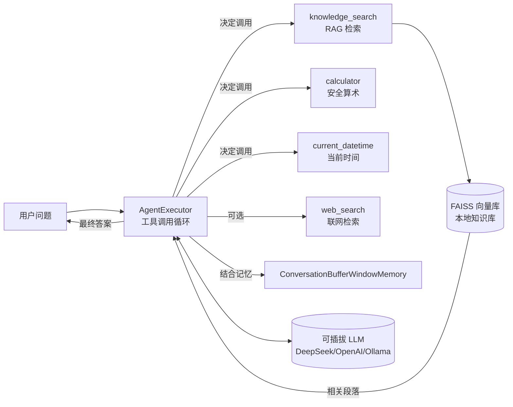

# AI Research Agent

[](https://github.com/g070817/ai-research-agent/actions/workflows/ci.yml)


> 一个基于 **LangChain** 的可插拔工具调用（Tool-Calling）Agent，用于**本地知识库 RAG 问答**。  
> 既是一份「学习 Agent 开发」的范例，也是一份可直接写进履历的、**测试完备**的工程项目。

---

## 为什么这个项目适合当履历项目

- **覆盖 Agent 核心栈**：LLM 决策循环、Tool Calling、Memory（多轮记忆）、RAG 检索、可插拔模型后端。
- **工程规范性**：src 布局、pyproject 打包、CLI 入口、配置集中管理、`.env` 不入库。
- **测试完备（重点）**：核心逻辑全部可用 **Fake 模型**做确定性单测——这对「AI 测试工程师」岗位是极强的加分项。
- **可复现的评估体系**：自带 golden QA 数据集 + 离线检索召回评估 + 在线端到端评估 + LLM-as-Judge。

---

## 架构



**Agent 主循环**：模型根据 `输入 + 记忆 + 工具 schema` 决定是直接回答还是调用某个工具 → 运行时执行工具并把结果回填 → 重复直到模型给出最终答案（或达到最大迭代次数）。

---

## 功能

| 工具                 | 作用                    | 类型       | 测试方式      |
| ------------------ | --------------------- | -------- | --------- |
| `knowledge_search` | 检索本地知识库相关段落           | RAG / 离线 | 检索召回率     |
| `calculator`       | 安全算术求值（AST 白名单，防代码注入） | 纯函数      | 单测 + 注入防护 |
| `current_datetime` | 返回当前准确时间              | 纯函数      | mock 时钟单测 |
| `web_search`       | 可选联网检索（需 `--web` 开启）  | 外部 / 集成  | 标记集成测试    |

---

## Quickstart

### 1. 环境准备

```bash
cd ai-research-agent
python3 -m venv .venv && source .venv/bin/activate
pip install -e ".[dev]"        # 安装依赖与自身包（提供 `agent` 命令）
cp .env.example .env            # 按需修改 .env
```

> 本项目基于 **LangChain 1.x**，经典 Agent 实现位于 `langchain_classic`（详见 `src/agent/agent.py`、`src/agent/memory.py`）。  
> 若 `python -m agent` 报 `No module named agent`，说明可编辑安装未把 `src` 加入路径，可用  
> `PYTHONPATH=src python -m agent ...` 运行，或确认 `pip install -e .` 已成功。

### 2. 选择 LLM 后端（三选一，推荐 DeepSeek）

- **DeepSeek（默认，国内可用、便宜）**：在 `.env` 填 `LLM_API_KEY=你的deepseek-key`，`LLM_PROVIDER=deepseek`。
- **OpenAI**：`LLM_PROVIDER=openai` + `OPENAI_API_KEY`。
- **Ollama（本地免费、离线）**：`LLM_PROVIDER=ollama`（需本地已拉取模型，如 `ollama run qwen2.5`）。

> 向量化（Embeddings）默认走本地 **Ollama**（`nomic-embed-text`，免费离线）。请先 `ollama pull nomic-embed-text`。  
> 若没有 Ollama，可在 `.env` 把 `EMBEDDINGS_PROVIDER` 改为 `openai`。

### 3. 构建知识库

```bash
python -m agent ingest          # 读取 data/docs 下的文档，生成 .cache/kb
```

### 4. 使用

```bash
python -m agent ask "LangChain 有哪些核心抽象？"     # 单问
python -m agent chat                                 # 多轮交互
python -m agent ask "星澜科技旗舰产品是哪年发布的？共几个档位？" --web
```

<details>
<summary>📸 示例输出（CLI）</summary>

```text
$ python -m agent ask "星澜科技旗舰产品是哪年发布的？"

🔍 knowledge_search → 命中 3 段相关段落（FAISS top-3）
🤖 星澜科技（成立于 2018 年，总部杭州）的旗舰产品「智核 Knowledge Hub」
   于 2021 年正式发布，定位企业级本地知识库智能问答平台，
   提供 RAG 检索、多轮记忆与可插拔 LLM 后端。

$ python -m agent ask "帮我算一下 (2+3) 的 2 次方再开方"
🤖 calculator → 25.0 的平方根为 5.0
```

</details>

### ⚠️ 联网检索与网络环境（必读）

`web_search` 默认后端是 **DuckDuckGo（通过 `ddgs`，免费、无需 key）**。但 DuckDuckGo 的多个检索后端
（startpage / mojeek / duckduckgo 等）在**中国大陆常因网络不可达而超时**——这不是代码 bug，是网络环境限制。

为此工具已做两层防护，避免「一调就卡死 / 甩异常栈」：

1. **整体硬性超时**（默认 `WEB_SEARCH_TIMEOUT=8` 秒）：即使 ddgs 内部跨多个后端重试，单次调用也不会无限挂起；
2. **失败时返回人话而非抛异常**：返回「联网检索超时（网络不可达）…请勿重复调用…建议查阅官方渠道」，
   Agent 据此干净放弃联网、退回到本地知识库作答或提示用户查官方来源。

可调配置：

```bash
export WEB_SEARCH_TIMEOUT=10     # 整体硬超时（秒），默认 8
```

#### 接入可插拔检索后端（让 --web 在中国大陆可用）

若要在不可达 DuckDuckGo 的环境下真正联网，可接入基于 **API key** 的检索服务（如 Tavily / SerpAPI / Bing）。
代码已预留 `provider` 抽象：`src/agent/tools/web_search.py` 的 `make_web_search_tool(provider=...)` 当前仅实现
`"duckduckgo"`，新增一个后端只需：

1. 在 `make_web_search_tool` 增加 `elif provider == "tavily": ...` 分支，用其官方 SDK/HTTP 实现一个 `_run`；
2. 在 `.env` 增加 `WEB_SEARCH_PROVIDER=tavily` 与对应 `TAVILY_API_KEY`；
3. CLI 的 `_resolve_web_tool` 把 `provider` / `api_key` 从 `Settings` 透传进去即可。

（此扩展不需要改动 Agent 主循环，体现了「可插拔工具」的设计价值。）

> **依赖迁移跟踪**：向量库 FAISS 当前经 `langchain-community` 引入，该包已进入 sunset（官方 2.0 移除）。
> 在 1.x 内其 FAISS 封装完全可用，导入处的 sunset 通知已在 `src/agent/rag/store.py` 精准抑制；
> 待 2.0 时迁移至对应独立集成包即可（`store.py` 是唯一改动点）。`

### 5. 测试（离线优先 + 集成测试分层）

```bash
pytest -q                       # 默认只跑离线单元测试（已通过 addopts 排除集成测试）
pytest -q -m integration        # 显式运行端到端集成测试（需真实 API key + Ollama）
```

- **单元测试**（18 个，默认）：工具单测（含注入防护）、RAG 检索、Agent 决策链（Fake 模型）、golden-QA 召回率评估——
  全部离线、毫秒级、零费用、可重复。
- **集成测试**（`tests/test_integration.py`）：真实 LLM + 真实向量库的端到端问答，断言答案含知识库中的确定性事实。
  无 `LLM_API_KEY` / 未启动 Ollama 时**自动跳过**，不会产生费用，也不会误触外部 API。

> 测试分层是 AI 工程的关键能力：把「确定性、可回归」的单测与「依赖外部、费钱、易变」的集成测试分开，
> CI 里默认只跑单测，集成测试按需人工/定时触发。

### 6. 评估

```bash
python eval/run_eval.py                 #


 离线：检索召回率
python eval/run_eval.py --llm           # 在线：端到端答案证据覆盖率
python eval/run_eval.py --llm --judge   # 在线 + LLM-as-Judge 打分
```

---

## 测试方法论（本项目最值得讲的点）

1. **用 Fake 模型隔离不确定性**：`tests/test_agent.py` 用 `FakeMessagesListChatModel` 预置「先调工具、再给答案」，使 Agent 决策链测试**无需真实 API、毫秒级、可重复**。
2. **纯函数工具强测试**：`calculator` 用 AST 白名单解析，单测覆盖正常计算**与代码注入防护**（`__import__('os')` 等必须被拒绝）。
3. **检索用确定性假向量**：`FakeEmbeddings` 让 RAG 测试完全离线、可复现。
4. **评估即回归**：golden QA 数据集 + 脚本化评估，做到「改一行代码，跑一遍评估」。

---

## 目录结构

```
ai-research-agent/
├── src/agent/
│   ├── __main__.py        # Typer CLI: ingest / chat / ask
│   ├── config.py          # 可插拔 Settings（环境变量）
│   ├── llm.py             # LLM / Embeddings 工厂（DeepSeek/OpenAI/Ollama）
│   ├── agent.py           # 组装 create_tool_calling_agent + AgentExecutor
│   ├── memory.py          # 窗口式对话记忆
│   ├── prompts.py         # 系统提示词
│   ├── tools/             # calculator / datetime / retriever / web_search
│   └── rag/               # ingest（加载+切分）/ store（FAISS 封装）
├── data/docs/             # 示例知识库文档（同时作为测试数据）
├── tests/                 # conftest + 四类测试 + golden_qa.json
├── eval/run_eval.py       # 检索/端到端/LLM-Judge 评估脚本
├── pyproject.toml
└── .env.example
```

---

## 学习路线建议（循序渐进）

1. 先跑通 `ingest` + `ask`，理解「文档 → 向量 → 检索 → 拼进 Prompt → 回答」这条 RAG 主线。
2. 读 `agent.py` 与 `tools/`，理解工具是如何被模型「看见」和「调用」的。
3. 读 `tests/test_agent.py`，理解如何用 Fake 模型验证 Agent 循环——这是 AI 测试的核心能力。
4. 试着新增一个工具（例如天气、汇率），体会工具定义的 schema 约束。
5. 把 `data/docs` 换成你自己的资料，做一个属于你的个人知识库问答。

---

## 可扩展方向（写进简历的进阶点）

- 把记忆升级为 `langgraph` 状态图，支持分支/回溯/人工介入。
- 给 `calculator` 加单元测试覆盖率 100%，并接入 CI。
- 用 `langsmith` / `langfuse` 做 tracing 与在线评估看板。
- 增加流式输出（`astream_events`）与 Web UI（FastAPI + 前端）。
- 把 golden QA 评估接入 GitHub Actions，做 LLM 回归门禁。

```
```
