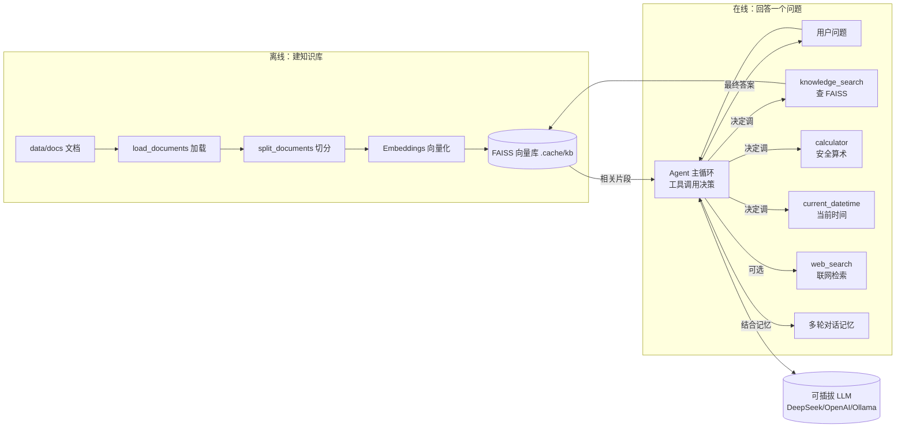

# AI Research Agent —— 从零读懂这个项目

> 这份导览写给**第一次接触 Agent / RAG 开发**的人。
> 目标：不靠死记硬背，顺着「数据怎么流、模型怎么想」两条线，把每个文件为什么存在、里面每段逻辑在干什么，都讲清楚。
> 读完后，你应该能自己改一段 prompt、加一个工具、或把知识库换成自己的资料。

---

## 0. 一句话定位

这是一个 **基于 LangChain 的「本地知识库问答 Agent」**：

- 你给它一堆文档（`data/docs/`），它先把文档切好、向量化、存进本地向量库；
- 你问问题，它**先查知识库**拿证据，再结合大模型的推理，**用证据回答你并标注来源**；
- 它还能算数、报时间、可选联网——这些能力都包装成「工具」，由大模型自己决定什么时候调用。

它同时是**学习范例**（代码注释极详细）和**简历项目**（测试完备、架构规范）。

---

## 1. 架构总览



两条主线：

- **离线构建线**（只在 `ingest` 时跑一次）：文档 → 切分 → 向量化 → 入库。
- **在线问答线**（每次 `ask`/`chat` 都跑）：问题 → Agent 决策 → 调工具/查库 → 答案。

---

## 2. 主线一：RAG 是怎么把「文档」变成「能回答问题的库」的

RAG = Retrieval-Augmented Generation（检索增强生成）。核心思想一句话：
**别让模型凭记忆瞎编，先去知识库里把相关段落找出来，喂给模型当证据。**

### 2.1 为什么要「切分」？

一篇文档几千字，直接整篇转成一个向量，语义会被「平均」掉，检索很模糊。
切成 ~800 字的小片段后，每段语义更聚焦，检索命中更精准。

- `chunk_size = 800`：每个片段最多约 800 字符（够讲清一个小主题）。
- `chunk_overlap = 120`：相邻片段重叠 120 字符，避免一个知识点被切在边界上而两边都不完整。
- `RecursiveCharacterTextSplitter`：优先在「段落 → 换行 → 句号 → 空格」等语义边界切，而不是生硬地数到第 800 个字符才下刀。

> 对应代码：`src/agent/rag/ingest.py` 的 `load_documents()` 与 `split_documents()`。

### 2.2 Embeddings 与向量是什么？

- **Embeddings（嵌入模型）**：把「文本 → 一串浮点数向量」的模型。语义相近的文本，向量在空间里也离得近。
- **FAISS**：向量索引库，给定查询向量，毫秒级返回「最相似的 k 个片段」。

`from_documents()` 把每个 chunk 向量化并建索引（首次建库）；`load()` 从磁盘恢复索引（后续问答复用，不必重新向量化）。

> 关于 `allow_dangerous_deserialization=True`：FAISS 用 pickle 序列化索引，理论上可执行任意代码，所以 LangChain 默认禁止。本项目里索引是**我们自己 ingest 生成的 `.cache/kb`**，来源可信，开启安全。**切记：绝不要用它加载来历不明的 `.cache/kb`。**
> 对应代码：`src/agent/rag/store.py` 的 `KnowledgeBase`。

### 2.3 一次问答的数据流

```
用户问："星澜科技的旗舰产品是哪年发布的？"
   ↓
Agent 决定先调 knowledge_search("星澜科技 旗舰产品 发布")
   ↓
retriever 去 FAISS 找最相似的 4 个片段（含 company_faq.md 里"2021 年发布"那一段）
   ↓
片段作为证据拼进 prompt
   ↓
模型结合证据回答："根据 company_faq.md，星澜科技旗舰产品智核 Knowledge Hub 于 2021 年发布。"
```

---

## 3. 主线二：Agent 主循环（模型是怎么「想」的）

这是理解整个项目的关键。所谓「工具调用型 Agent」，本质是让大模型在一个循环里反复做
**决策 → 执行 → 再看结果**：

```
第 0 步  组装 prompt：
            system（角色原则）
            + chat_history（最近几轮，见 memory.py）
            + input（用户本轮问题）
            + agent_scratchpad（工具调用与结果的暂存区，模型自动维护）

第 1 步  把 prompt 交给 LLM，LLM 二选一：
            (a) 直接输出最终答案 → 结束
            (b) 决定「调用某工具」并给参数（tool_calls），如 knowledge_search("...")

第 2 步  运行时执行该工具，拿到结果字符串，写回 agent_scratchpad

第 3 步  再次把整段 prompt（含刚写入的工具结果）交给 LLM，
            LLM 决定：继续调下一个工具，还是已经能给出最终答案

……重复，直到最终答案，或达到 max_iterations（本例 8 次）
```

**为什么这种范式好？** 模型只负责「想调用什么、传什么参数」，真正干活的是我们写好的工具函数；模型**永不接触危险操作**（如直接 `eval` 用户输入），安全可控。

> 对应代码：`src/agent/agent.py` 的 `build_agent()`（组装循环）与 `ConversationalAgent.invoke()`（单轮执行）。

---

## 4. 逐个模块拆解（按一次问答的调用顺序）

| 顺序 | 模块 | 文件 | 一句话职责 |
|---|---|---|---|
| 1 | 配置 | `config.py` | 从环境变量读所有可插拔设置（LLM 后端、模型名、记忆窗口、超时…） |
| 2 | 模型工厂 | `llm.py` | 按配置构造 LLM 与 Embeddings，支持 DeepSeek/OpenAI/Ollama 三后端 |
| 3 | 文档摄入 | `rag/ingest.py` | 加载 `data/docs` 文档、切分成 chunk |
| 4 | 知识库 | `rag/store.py` | FAISS 封装：建库 / 加载 / 持久化 / 检索 |
| 5 | 工具集 | `tools/` | calculator / datetime / retriever / web_search 四个工具 |
| 6 | 记忆 | `memory.py` | 用消息列表维护多轮对话，按窗口裁剪 |
| 7 | 提示词 | `prompts.py` | 系统提示词：定义 Agent 的角色与行为原则 |
| 8 | 装配 | `agent.py` | 把上面所有东西组装成可运行的 Agent 主循环 |
| 9 | 入口 | `__main__.py` | Typer CLI：ingest / ask / chat 三个命令 |

### 4.1 config.py —— 所有旋钮集中在这里

- 默认从环境变量读，缺失时用合理默认值（如 `LLM_PROVIDER=deepseek`）。
- `api_key` 按优先级 `LLM_API_KEY → DEEPSEEK_API_KEY → OPENAI_API_KEY` 取值。
- 测试时可直接 `Settings(...)` 覆盖任意字段，无需动环境变量。
- `model_for()` / `base_url_for()` / `embeddings_model_for()` 把「provider → 具体模型名/地址」的映射收敛在一处。

### 4.2 llm.py —— 可插拔模型后端

- `build_llm()`：DeepSeek/OpenAI 走 OpenAI 兼容接口（DeepSeek 自动补 `https://api.deepseek.com/v1`）；Ollama 走本地。缺 key 时抛清晰错误。
- `build_embeddings()`：默认 Ollama 的 `nomic-embed-text`（免费、离线），也可切 OpenAI。

### 4.3 rag/ingest.py 与 rag/store.py —— 见第 2 节。

### 4.4 tools/ —— Agent 的「手脚」

工具就是「给大模型用的一组函数」。每个工具都要有：
- **名字**（如 `knowledge_search`）
- **描述**（写给模型看的，决定它会不会调）
- **参数 schema**（模型据此填参）

四个工具：

| 工具 | 作用 | 设计要点 |
|---|---|---|
| `knowledge_search` | 查本地知识库 | 工厂函数 `make_retriever_tool` 用闭包注入 retriever，便于测试替换 |
| `calculator` | 安全算术 | **AST 白名单**，见 4.5 |
| `current_datetime` | 当前时间 | UTC→本地时区，返回 ISO8601 带偏移 |
| `web_search` | 可选联网 | **超时防护**，见 4.6 |

### 4.5 calculator.py —— 为什么不用 eval？

LLM 生成的字符串直接 `eval` 是严重安全隐患（命令注入）。
这里用 **AST 白名单**解析：把表达式编译成语法树，逐节点下钻，**只放行**数值、白名单运算符/函数/常量。

例如 `sqrt(144) + 2**3` 被拆成：
```
BinOp(+)
├─ Call(sqrt, [144])
└─ BinOp(**)
   ├─ 2
   └─ 3
```
递归求值，遇到 `__import__('os')` 这类不在名单的节点直接拒绝——**白名单优于黑名单**，从根上杜绝任意代码执行。

### 4.6 web_search.py —— 联网为什么要做超时防护？

默认后端 DuckDuckGo 在中国大陆常因网络不可达而超时；而 `ddgs` 自带超时是「每次后端尝试」的超时，还会跨多个后端重试，单次调用可能卡很久。
所以做了两层防护：

1. **整体硬性超时**（默认 8 秒）：用线程池 `future.result(timeout=...)` 兜底，确保 Agent 不会长时间卡死；
2. **失败时返回人话而非抛异常**：告诉模型「联网超时，请勿重复调用，改用本地知识库或建议查官方渠道」——让 Agent 干净降级。

> 可插拔扩展：`make_web_search_tool(provider=...)` 已预留分支，接 Tavily/SerpAPI 只需加一个 `elif` 并在 `.env` 配 key。

### 4.7 memory.py —— 多轮记忆怎么滚动？

- 历史存成 `list[BaseMessage]`，每轮 = 1 条 HumanMessage + 1 条 AIMessage。
- `window_messages(history, k)` 只保留最近 `k*2` 条（`history[-k*2:]`），既给模型足够上下文，又避免历史无限膨胀撑爆窗口。
- 为何不用 LangChain 旧的 `ConversationBufferWindowMemory`？1.x 已废弃，且最终指向 LangGraph（对教学项目过重）。用普通列表最透明、零废弃依赖。

### 4.8 prompts.py —— Agent 的「人设」

`SYSTEM_PROMPT` 定义角色（严谨研究助手）与行为原则：优先查库、算数必用工具、标注来源、未覆盖就明说、用用户语言回答。这是**最先该改的地方**——想让 Agent 风格不同，调这里。

### 4.9 agent.py —— 把一切组装成循环

- `build_prompt()`：把 system / chat_history / input / scratchpad 四个槽位按序喂给模型（`MessagesPlaceholder` 负责把一组消息原样展开，保留每条的角色）。
- `build_agent()`：基础工具（计算、时间）永远有；有 retriever 加 `knowledge_search`；显式 `--web` 且依赖可用加 `web_search`；再用 `create_tool_calling_agent` + `AgentExecutor`（max_iterations=8 防死循环，handle_parsing_errors 容错）驱动循环。
- `ConversationalAgent`：在 Executor 外面包一层记忆管理，对外暴露 `.invoke()` / `.tools`，行为与原 AgentExecutor 兼容。

### 4.10 __main__.py —— CLI 三条命令

- `ingest`：只做知识库（读文档→切分→向量化→存盘），不需要 LLM。
- `ask`：加载知识库→造 LLM→组装 Agent→问一个问题。
- `chat`：同 `ask`，但进入循环，每轮把 human/ai 写入记忆，支持多轮。
- 易失败步骤（造 LLM/Embeddings）包成 `*_or_exit`，缺 key 或 Ollama 未启动就打印友好提示并干净退出，而不是甩异常栈。

---

## 5. 怎么跑起来（浓缩版）

```bash
cd ai-research-agent
python3 -m venv .venv && source .venv/bin/activate
pip install -e ".[dev]"
cp .env.example .env          # 填 LLM_API_KEY（DeepSeek 默认），按需改

# 向量化（默认走本地 Ollama 的 nomic-embed-text，需先 ollama pull nomic-embed-text）
python -m agent ingest

# 问答
python -m agent ask "LangChain 包含哪些核心抽象？"
python -m agent chat         # 多轮交互

# 测试（离线单测，毫秒级、零费用）
pytest -q
```

> 详细配置、联网检索注意事项、评估脚本见 `README.md`。

---

## 6. 推荐学习路线

1. 先跑通 `ingest` + `ask`，亲眼看到「文档 → 向量 → 检索 → 拼 prompt → 回答」这条 RAG 主线。
2. 读 `agent.py` 与 `tools/`，理解工具是怎么被模型「看见」和「调用」的。
3. 读 `tests/test_agent.py`，理解如何用 **Fake 模型**验证 Agent 循环——这是 AI 测试的核心能力（无需真实 API、可重复）。
4. 试着新增一个工具（如天气、汇率），体会 schema 约束怎么写。
5. 把 `data/docs` 换成你自己的资料，做一个属于你的个人知识库问答。

---

## 7. 常见疑问 / 踩坑

- **`python -m agent` 报 `No module named agent`？** 可编辑安装未把 `src` 加入路径，用 `PYTHONPATH=src python -m agent ...`，或确认 `pip install -e .` 成功。
- **联网检索一直超时？** 多为网络环境限制（非代码 bug）。Agent 会干净降级到本地知识库，详见 `web_search.py` 的超时防护。
- **`allow_dangerous_deserialization` 危险吗？** 仅当你加载**自己生成的** `.cache/kb` 时安全；不要加载他人给的索引目录。
- **想换大模型？** 改 `.env` 的 `LLM_PROVIDER` / `LLM_MODEL` 即可，`llm.py` 已封装好三后端。
